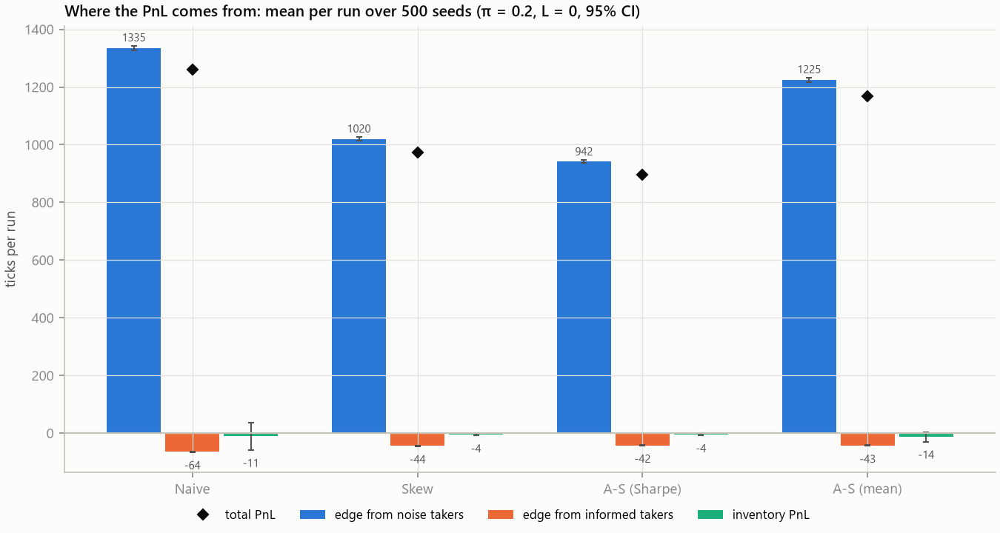
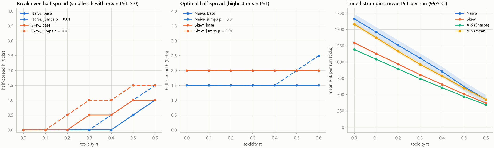
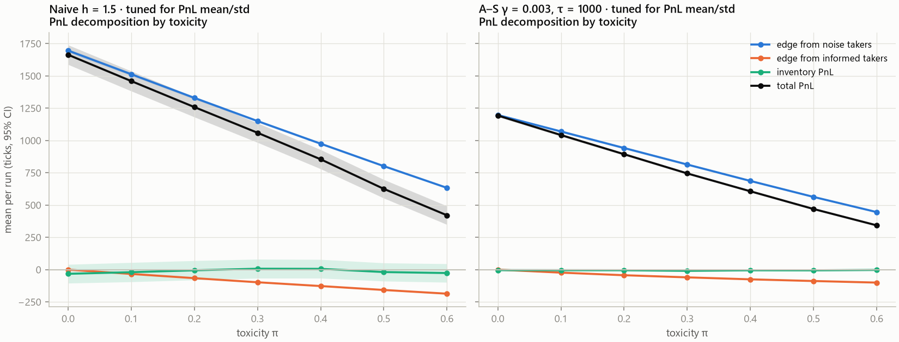
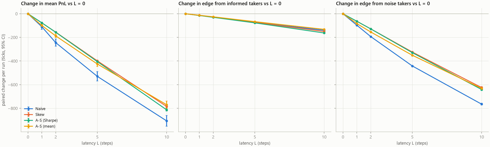

# Market Making Under Adverse Selection

[](https://github.com/karoldudzicz/market-making-adverse-selection/actions/workflows/ci.yml)

In a simulated limit order book, toxic flow costs a market maker mostly through lost spread income rather than losses to informed traders, each step of quote latency costs about 9% of PnL, and Avellaneda-Stoikov controls inventory but not adverse selection.

## Key findings

In this model the spread width is set by the structure of the book rather than by π: the optimal half-spread does not move in the baseline, and only with jumps five times more frequent does naive quoting's optimal half-spread rise, from 1.5 to 2.5 ticks at π = 0.6. π lowers income mainly by displacing noise flow, and the levers that matter to a market maker are inventory control (variance) and latency (mean PnL).

- **Raising the informed share π by 0.1 costs about 200 ticks per run, ~85% through displaced noise flow and ~15% through adverse selection.** At its optimal half-spread, which is 1.5 ticks at every π in the baseline, the naive market maker's mean PnL falls linearly from 1,664 ticks per run at π = 0 to 421 at π = 0.6, by 199 to 229 ticks per +0.1 step (paired, same seeds). Informed takers replace noise takers and trade only when the book is mispriced by more than θ, so most of each step is lost edge from noise takers. The loss on fills against informed takers grows by 29 to 33 ticks per step.
- **Latency costs about 80 ticks per run per step for skew and for Avellaneda-Stoikov (A-S) tuned for PnL mean/std, with no saturation up to 10 steps.** For A-S the PnL change against zero latency is −77, −157, −405 and −813 ticks at L = 1, 2, 5 and 10 steps, about 9% of its zero-latency PnL per step, and skew loses 77-80 ticks per step. Naive quoting loses 91-122 ticks per step and A-S tuned for mean PnL loses 77-100. Both saturate mildly, losing less per step at longer latencies. About 80% of the cost shows up as lower edge from noise takers. This is consistent with stale quotes that have become too generous sitting at the top of the book, where any taker hits them.
- **Inventory control cuts the PnL standard deviation 8.6 times at a cost of 29% of mean PnL.** At π = 0.2, A-S tuned for PnL mean/std earns 896 ± 6 ticks per run with a standard deviation of 64 and a mean |q| of 0.6 lots, against 1,260 ± 48, 550 and 9.4 for naive quoting. With a constant τ, A-S is a linear skew (0.75 ticks per lot of position) whose half-spread (1.97 ticks) is tied to γ and k. A skew with free h and α has a similar PnL mean/std ratio (13.9 vs 14.0) and earns 77 ± 3 ticks more per run on the same seeds.
- **A-S does not protect against informed flow.** The loss per informed fill is similar for every strategy (−2.40 to −2.60 ticks). A-S loses less in total (−42 against −64 ticks per run) only because its wider quotes are hit less often. 41-50% of the loss to informed takers happens within 20 steps of a price jump, about 4% of the time.

## Results

**Where the PnL comes from (E3).** Mean per run over seeds 1000-1499 at π = 0.2 and zero latency, with the edge per fill by counterparty type on the right.



| Strategy (tuned for) | Mean PnL, 95% CI | PnL std | PnL mean/std | Mean \|q\| | Fills per run |
|---|---|---|---|---|---|
| Naive, h = 1.5 (PnL mean/std) | 1,260 ± 48 | 550 | 2.3 | 9.4 | 870 |
| Skew, h = 2, α = 0.5 (PnL mean/std) | 973 ± 6 | 70 | 13.9 | 0.8 | 596 |
| A-S, γ = 0.003, τ = 1000 (PnL mean/std) | 896 ± 6 | 64 | 14.0 | 0.6 | 553 |
| A-S, γ = 0.01, τ = 10 (mean PnL) | 1,169 ± 17 | 194 | 6.0 | 3.2 | 664 |

| Paired difference on the same seeds | Mean, 95% CI | Seeds where the first is better |
|---|---|---|
| Skew − Naive | −287 ± 47 | 28% |
| A-S (PnL mean/std) − Naive | −364 ± 47 | 24% |
| A-S (mean PnL) − Naive | −91 ± 41 | 40% |
| A-S (PnL mean/std) − Skew | −77 ± 3 | 0.4% |

**Toxicity (E4).** Break-even and optimal half-spreads and the tuned strategies' PnL against π (seeds 1000-1199; dashed: jump probability 0.01, seeds 1000-1099), and the PnL decomposition against π. The break-even half-spread stays at 0 up to π = 0.4 for naive quoting (0.2 for skew) and rises to 1 tick at π = 0.6. The optimal half-spread does not move in the baseline (1.5 ticks naive, 2 ticks skew), and no π ≤ 0.6 makes every spread unprofitable. At π = 0.6 the four tuned strategies earn 343 to 422 ticks per run, against 1,193 to 1,664 at π = 0. Naive quoting's lead over skew and A-S tuned for PnL mean/std therefore narrows with π, from 369-471 ticks at π = 0 to 52-78 at π = 0.6. With jumps five times more frequent, the naive maker's optimal half-spread rises from 1.5 to 2.5 ticks at π = 0.6, its break-even half-spread reaches 1.5 ticks, its loss to informed takers there is 2.6 times larger, and its best PnL is 184 ± 169 ticks, no longer distinguishable from zero.




**Latency (E5).** Paired change against L = 0 of the PnL and of the edge from each counterparty type (seeds 1000-1499, π = 0.2).



Other outputs in [`results/`](results): E0 model diagnostics and the k calibration, E1 an example run, E2 PnL distributions, E4 PnL against the half-spread for every π, E6 markouts, the tuning grids, and a CSV behind every figure.

## Model

One instrument, discrete time, 5,000 steps per run. Prices are integer ticks and the true value starts at 10,000 ticks.

| Component | Specification |
|---|---|
| True value V | Gaussian random walk with σ = 0.5 ticks per step, plus ±10-tick jumps with probability 0.002 per step. Hidden from the market maker. |
| Background liquidity (price anchor) | Four providers post 1-lot post-only limit orders 2-10 ticks around $R_t = V_{t-d} + \varepsilon_t$, with d = 5 steps and $\varepsilon_t \sim N(0, 1)$. Orders are cancelled after a geometric lifetime (5% per step), when more than 15 ticks from $R_t$, or when at or through $R_t$. This is the rest of the market, which learns V with a delay. With it, the mean distance between the market mid and V is 1.37 ticks (E0). |
| Takers | A taker arrives with probability λ = 0.3 per step and sends a 1-lot market order. With probability π it is informed: it buys if the best ask is below $V_t - \theta$, sells if the best bid is above $V_t + \theta$ (θ = 1 tick), and otherwise does nothing. Otherwise it is a noise taker with a random side. |
| Market maker | Sees the book, its own position and σ, but not V. Quotes one 1-lot order per side around the background mid (the mid of the book without its own orders), with a position limit $\lvert q \rvert \le 20$. Quotes computed in step t become active in step t + L. |

Each step: (1) V moves; (2) the market maker quotes from the book left by the previous step, and the quotes due in this step are activated; (3) background liquidity acts; (4) a taker may arrive; (5) the state is recorded.

Strategies, with s the background mid and q the position (bids rounded down, asks up to whole ticks):

- **Naive:** $s \mp h$.
- **Inventory skew:** $s - \alpha q \mp h$.
- **Avellaneda-Stoikov:** reservation price $r = s - q\gamma\sigma^2\tau$, total spread $\delta = \gamma\sigma^2\tau + \frac{2}{\gamma}\ln(1 + \gamma/k)$, quotes $r \mp \delta/2$, with a constant rolling horizon τ and k = 0.628 per tick calibrated in E0.

## PnL decomposition

For a fill with sign s (+1 buy, −1 sell) at price P in step t, with $V_t$ taken after that step's value move:

$$\text{cash}_T + q_T V_T = \underbrace{\sum_{\text{noise}} s(V_t - P)}_{\text{edge from noise takers}} + \underbrace{\sum_{\text{informed}} s(V_t - P)}_{\text{edge from informed takers}} + \underbrace{\sum_t q_{t-1}(V_t - V_{t-1})}_{\text{inventory PnL}}$$

The identity is exact and is checked by a property-based test for every strategy. The edge from noise takers is spread capture, and the edge from informed takers is the adverse-selection loss. The markout of a fill at horizon h is $s(V_{t+h} - P)$.

## Methodology

- **Seeds.** Calibration and tuning use seeds 0-199, and every reported result uses seeds 1000-1499. E4 uses seeds 1000-1199 and its jump-frequency variant seeds 1000-1099, to keep the full pipeline at about 15 minutes.
- **Paired comparisons.** All market randomness (value path, background order flow, takers) is drawn up front from separate seeded streams. On a given seed, every strategy, π and L therefore faces the same market, and raising π turns a fixed subset of noise takers into informed ones. Differences between strategies or settings are computed per seed.
- **Confidence intervals.** 95%, normal approximation. Edges per fill are pooled ratios over runs with delta-method intervals.
- **Calibration of k (E0).** Naive runs with h from 0 to 6 ticks give the fill rate per quoted side per step against the distance from the background mid. log A − kδ is fitted by least squares weighted by fill counts: A = 0.216, k = 0.628 per tick, R² = 0.84.
- **Tuning.** Grids over h, α, γ and τ at π = 0.2 and L = 0 (`results/tuning_*.csv`). The objective is the ratio of mean to standard deviation of run PnL across seeds, with a one-standard-error rule. A-S tuned for mean PnL is reported as a risk-neutral contrast.
- **Model check (E0).** The mean |mid − V| is 1.37 ticks, does not drift over a run, and returns to normal 9 steps after a jump.
- **Reproducibility.** `run_all` reruns the calibration and tuning and stops if they select parameters other than those in `src/mmsim/config.py`. Two full runs produce byte-identical CSV files.

## Design decisions

- All limit orders (market maker and background) are post-only: a price that would cross the book slides to one tick behind the best opposite price. Takers are therefore the only aggressors. Market orders are immediate-or-cancel.
- The market maker keeps a resting quote whose price is unchanged, so it does not lose queue priority. The position limit is checked when a quote is activated, against the position at that moment.
- When one side of the book is empty, the mid falls back to the last two-sided mid seen for the same view.
- Background order lifetimes are drawn as geometric at posting, which is equivalent to a 5% per-step cancel probability but independent of the state of the book, so the market does not depend on the strategy.
- Background liquidity also cancels its orders at or through its own reference (bid $\ge R_t$ or ask $\le R_t$). This rule is an addition to the base specification, which cancels only orders more than 15 ticks away. Without it, after a 10-tick jump the orders left on the wrong side of the new value stay until they expire, and the mid needs 40 steps instead of 9 to return to its normal distance from V (E0). The rule makes d the actual information delay of the background, and it can be switched off with `BackgroundConfig.cancel_through_reference`.
- Background liquidity: 4 providers, each posting a 1-lot order per side with probability 0.25 per step. The default π is 0.2. The book starts empty and fills within the first steps.
- Quotes are rounded outward to whole ticks with a 1e-9 tolerance against float noise. If rounding leaves bid ≥ ask, the ask is set to bid + 1.
- A-S uses a constant rolling horizon τ instead of τ = T − t. With T = 5,000 and σ = 0.5, σ²(T − t) is about 1,250 at the start of a run, so the original form would quote extremely wide and skewed early and almost unskewed late. `AvellanedaStoikovConfig(horizon=None)` gives the original form.
- The tuning objective is the ratio of mean to standard deviation of run PnL across seeds. Among grid points within one standard error of the best ratio (√((1 + S²/2)/n), where S is the mean/std ratio of a grid point and n the number of tuning seeds, 200), the one with the highest mean PnL is selected. V is a martingale, so inventory has zero expected PnL; a mean-PnL objective drives α and γ·τ towards zero and makes skew and A-S identical to naive quoting.
- The break-even half-spread is the smallest h on a 0.5-tick grid with mean PnL ≥ 0. A value of 0 means the tightest quotes are already profitable.
- The loss attributed to jumps is the edge on informed fills in the step of a jump or the 19 steps after it. The window covers the background delay and the 9-step recovery of the mid.
- Markouts at horizon h exclude fills with t + h past the end of the run, and markout curves pool runs weighted by their fill counts.

## Limitations

- **Fill intensity is step-shaped, so k is an approximation.** The fill rate is flat at 0.12-0.14 per side per step up to 1 tick from the mid and falls much faster than exponentially beyond the background's best quotes about 2 ticks away. The exponential fit behind A-S has R² = 0.84 and overestimates the fill rate in the tail by up to 7 times at 6.5 ticks (E0).
- **The optimal half-spread reflects the simulated book.** Background providers quote 2-10 ticks from their reference, so their best quotes usually sit about 2 ticks from the mid. The optimal half-spreads (1.5 ticks naive, 2 ticks skew) place the market maker at or just inside that level. In the baseline they do not move with π because adverse selection is small relative to spread income. They are a property of this book, not a general result.
- **E4 re-optimises only part of the strategies.** The half-spread of naive and skew quoting is optimised separately at every π (skew keeps α = 0.5), while the A-S parameters stay fixed at the values tuned at π = 0.2.
- **The position limit shapes the naive result.** Naive quoting reaches |q| = 20 in almost every run (mean maximum |q| of 19.8) and then quotes only the side that reduces the position. The limit acts as a crude inventory control, so the naive PnL and its standard deviation depend on it.
- **π is a share of arrivals, and informed takers trade rarely.** An informed taker trades only when the best quote is more than θ = 1 tick through V. Without a market maker, about 9 of the roughly 300 informed arrivals per run at π = 0.2 trade (E0). Raising π therefore mainly removes noise flow, which is why most of the cost of toxicity is lost spread income. Adding informed flow on top of a fixed noise flow would isolate adverse selection.
- **Markouts are flat by construction.** Markouts are measured against V, a martingale, and informed takers trade on the current V. The loss on an informed fill is therefore complete at the fill: −2.4 to −2.6 ticks per lot at every horizon (E6). Markouts against the market mid would show how prices adjust after fills; they are not computed.
- **Latency costs are upper bounds.** They are measured with the parameters tuned for L = 0. Retuning h, α or γ·τ for each latency to maximise mean PnL could only reduce the loss, because the L = 0 parameters remain one of the options.
- **The jump-frequency variant is noisy.** It uses only seeds 1000-1099 to fit the time budget, naive PnL intervals are ±155 to ±194 ticks, and the strategy parameters are not retuned for it.
- **A-S uses a constant rolling horizon.** With τ fixed, γ and τ act only through γ·τ, and the strategy is a linear inventory skew. The original τ = T − t form had a lower mean PnL for every γ on the tuning seeds (at best 912 against 1,207 ticks) and is not reported.
- **The market maker knows σ and does not learn V from the order flow.** Background liquidity does that for it, with delay d.
- **Scope.** One instrument, synthetic order flow, 1-lot orders, no fees or rebates, and latency in simulation steps rather than wall-clock time.

## How to run

Requires [uv](https://docs.astral.sh/uv/). Install it once:

```powershell
# Windows (PowerShell)
powershell -ExecutionPolicy ByPass -c "irm https://astral.sh/uv/install.ps1 | iex"
```

```bash
# macOS / Linux
curl -LsSf https://astral.sh/uv/install.sh | sh
```

Then, in the repository root (same commands in PowerShell and bash):

```bash
uv sync
uv run python -m pytest
uv run ruff check .
uv run ruff format --check .
uv run python -m mypy src
uv run python -m mmsim.experiments.run_all   # every result in results/, about 15 min on 12 threads
```

Single experiments run with `uv run python -m mmsim.experiments.<module>`, where the module is `calibrate` (E0), `tune`, `compare` (E1, E2, E3, E6), `breakeven` (E4) or `latency` (E5).

## References

- Avellaneda, M., & Stoikov, S. (2008). High-frequency trading in a limit order book. *Quantitative Finance*, 8(3), 217-224.
- Glosten, L. R., & Milgrom, P. R. (1985). Bid, ask and transaction prices in a specialist market with heterogeneously informed traders. *Journal of Financial Economics*, 14(1), 71-100.
